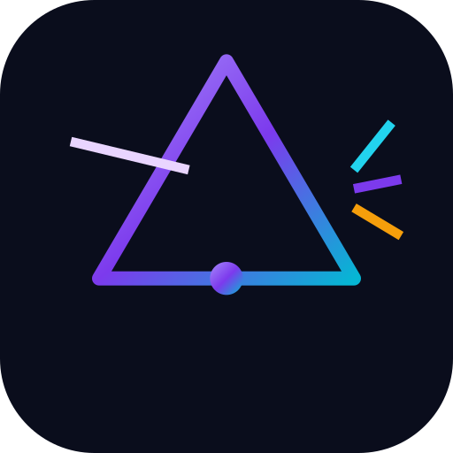
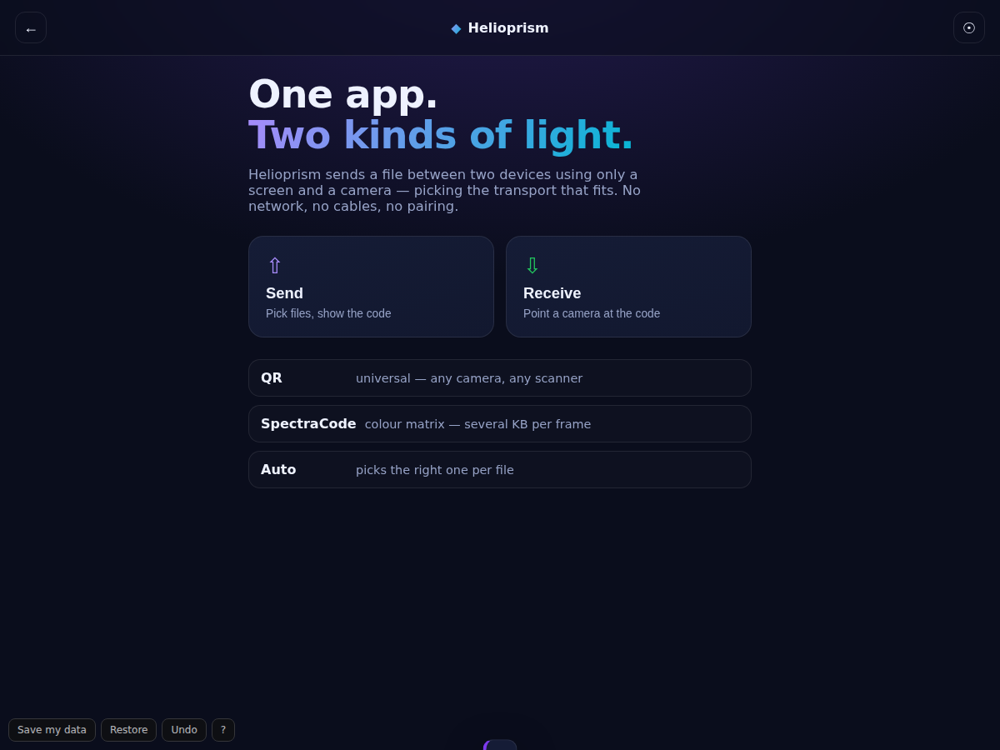

<div align="center">



# Helioprism

<!-- shot:start -->



<!-- shot:end -->

**One app. Two kinds of light.**

Move a file between two devices using only a screen and a camera — no network,
no cables, no pairing. Helioprism carries the same rateless frame stream over
**two physical transports** and picks the right one for the job.

[](LICENSE)
[](COMMERCIAL.md)
[](https://github.com/drsamonline/helioprism/commits)
[](https://github.com/drsamonline/helioprism/stargazers)
[](https://github.com/drsamonline/helioprism/releases)
[](https://drsamonline.github.io/helioprism/play/)

**[Live demo](https://drsamonline.github.io/helioprism/play/)** &nbsp;·&nbsp;
**[Landing page](https://drsamonline.github.io/helioprism/)** &nbsp;·&nbsp;
**[All projects](https://drsamonline.github.io/)**

**Download:** [Windows (.exe)](https://github.com/drsamonline/helioprism/releases/latest/download/helioprism-portable.exe) &nbsp;·&nbsp; [Android (.apk)](https://github.com/drsamonline/helioprism/releases/latest/download/helioprism.apk)

</div>

---

## The two transports

| | **QR** | **SpectraCode** |
|---|---|---|
| Physical layer | monochrome QR modules | 36-colour cells, 5 bits each |
| Per frame | ~1.4 KB | ~5.1 KB |
| Strength | any camera reads it; any scanner reads a tiny file | far more capacity per frame |
| Best for | small files, cheap optics, maximum compatibility | larger files |

Both carry the **same** frame format and the **same** rateless fountain stream, so
a missed frame costs one more symbol rather than a whole loop. The magic byte in
each frame says which layer carried it, so the receiver **auto-detects** — point
one receiver at either code and it works.

## How it works

```
files ─▶ container ─▶ fountain symbols ─▶ frames ─▶ QR  or  colour matrix
                                                            │
        files ◀─ container ◀─ collector ◀─ frame ◀─ camera ─┘
```

- **Selection engine** — auto-picks QR for small payloads and the colour
  transport for large ones, or you choose.
- **Compatibility mode** — a small text file can go out as one plain QR that any
  third-party scanner reads.
- **Offline-first PWA** — installable; after first load it never touches the
  network.

## Quick start

```bash
git clone https://github.com/drsamonline/helioprism.git
cd helioprism
npm install
npm run dev      # http://localhost:3000
npm test         # both transports, end to end
npm run build    # production bundle into docs/play/
```

Open the dev URL on both devices (or install the PWA). On one, **Send** and pick
files; on the other, **Receive** and point the camera.

## Project layout

```
src/
  index.html  styles.css  main.js  sw.js
  transports/
    index.js      registry + selection engine
    qr.js         QR transport (monochrome)
    spectra.js    SpectraCode transport (colour)
  lib/
    container.js  shared multi-file container
    fountain.js   shared LT fountain codes
    frame.js      shared frame format + collector (per-transport magic)
    qr/           QR encode (qrcode-generator) / decode (jsQR)
    spectra/      arithmetic coder, match model, Reed-Solomon, colour matrix,
                  optical decoder
  workers/        optical decode worker for the colour transport
tests/            frame, fountain, selection + both transport loopbacks
tools/            build.mjs, dev.mjs, serve.js
docs/             landing page + built demo (GitHub Pages)
```

## Testing

```bash
npm test
```

Both transports are tested end to end in Node: files → the transport's real
`render()` (into a mock canvas) → pixels → the transport's `decodeFrame()` →
collector → files.

## Licence

Helioprism is **free for personal, academic, hobby and non-profit use** under the
[PolyForm Noncommercial License 1.0.0](LICENSE). **Commercial use needs a paid
licence** — see [COMMERCIAL.md](COMMERCIAL.md).

Third-party components are listed in [NOTICE](NOTICE).

## Credits

Built by **Dr Sohil Momin** ([@drsamonline](https://github.com/drsamonline)).
Helioprism combines the two transports developed as **BlinkTransfer** (QR) and
**BlinkCode AI** (SpectraCode).
